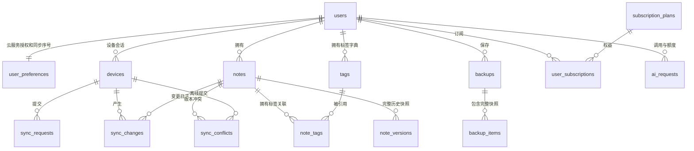

# 架构与分工

## 业务 ER 图

`backup_items.note_id` 与 `notes.source_note_id` 是快照来源信息，不设置依赖原笔记存在的外键。其他涉及笔记、标签、设备和备份的关联使用 `(user_id,id)` 组合外键，数据库同时验证资源存在和用户归属。

## 五人工作包

|成员|业务模块|表数 / 字段数|代码与验收责任|
|---|---|---|---|
|一|account|3 / 34|注册登录、设备令牌、资料与云授权；验证刷新轮换和撤销|
|二|note|3 / 25|笔记标签、筛选、版本化统一写入入口；验证隔离和存储限制|
|三|sync|3 / 29|幂等推送、增量拉取、三种冲突解决；验证双设备和并发提交|
|四|backup|3 / 27|备份、完整性校验、新笔记恢复、历史恢复；验证原文标签完整|
|五|cloud|3 / 35|套餐订阅、AI 适配、预占额度；验证并发不超额及失败退款|

公共的响应、异常、参数化 SQL、安全配置和测试设施由五人共同维护。各模块均提供实体及 MyBatis-Plus BaseMapper；普通标签读取使用 MyBatis-Plus，涉及联表、用户行锁和多表聚合的操作通过 `common.SqlMapper` 使用参数化 SQL。这些操作共享 Spring JDBC 事务，不能绕过统一写入入口直接更新笔记。

## 一致性约定

- 所有用户写操作先锁 `users` 中同一行，再读订阅、设置、用量和目标数据。持锁期间完成修改后提交，避免同步序号先分配后提交导致漏拉。
- 笔记完整快照、关系标签、历史和同步日志在同一事务中提交；批量同步出现参数、容量或关联错误时整批回滚。正常的版本冲突作为每条结果保存，其余合法变更可一起提交。
- 云端同步的基本单位是“笔记及全部标签”，不单独同步标签字典；历史和备份因此不依赖当前标签关系即可恢复。
- 冲突保留提交与云端两个快照，解决时携带**当前**云端版本。`server` 保留当前内容，`submitted` 应用离线内容，`merged` 使用客户端提交的合并内容。
- AI 预占和完成分别使用短事务，外部调用在事务外。唯一请求键保证只调用一次；成功、失败与 pending 状态可重放。pending 超过调用超时加六十秒会回收，进程崩溃不会永久占额。
- 配额只统计本月 succeeded 和有效 pending；失败不扣额。单次请求归属预占时的 UTC 月份，跨月完成仍归原月份。
- 容量为当前笔记快照、未过期历史、未过期备份项的 UTF-8 字节总量；含版本和时间等快照元数据。创建或修改会同时新增当前和历史快照，检查两份净增量。
- 删除允许在授权关闭、订阅到期或容量超限时执行，因此删除墓碑及历史记录允许暂时超出容量；删除不能视为立即释放所有快照空间。备份删除可立即释放对应备份项的容量。
- 各次快照恢复创建新版本和同步变更。备份整体恢复是原子事务，容量不足全部回滚；重复恢复属于新操作，会产生另一组新笔记。
- 备份校验采用有序笔记快照的 SHA256 清单摘要，每项也有独立 SHA256；提供完整性校验，不提供数字签名或数据库静态加密。

## Flutter 后续接入

保持 SQLite 为首要读写来源。另增用户隔离、设备 UUID、笔记 UUID、本地修改队列、服务端版本和同步游标，不能将目前本地自增整数直接当成云端 UUID。详细映射及处理顺序见接口文档。本次代码没有修改 Flutter。
